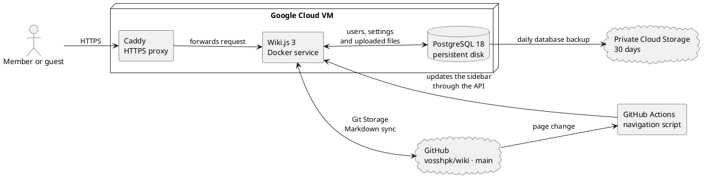

# Infrastructure

This page explains where the wiki content is stored and what the technical services do.
It is intended for technically curious readers and people who maintain the wiki.

## How content is updated

Page text is stored as Markdown files in the [vosshpk/wiki GitHub repository](https://github.com/vosshpk/wiki).
GitHub is a service for storing files, tracking changes and collaborating on projects.
Markdown is a simple text format for headings, lists, links and tables.
Wiki.js uses Git Storage to synchronize pages between the wiki and the main branch in GitHub.
Synchronization runs on a schedule that is currently set to every five minutes.
GitHub Actions runs the navigation script when pages change, and the script waits for the content to sync before updating the sidebar.
The Wiki.js interface controls group labels, order, and placement for links that already exist in the sidebar.
The script uses the group list in `wiki-infrastructure-v3/scripts/generate-inline-navigation.mjs` as the default placement for new links.
New links in top-level folders that are not listed in a navigation group go under **Ungrouped**.
If such a folder has no landing page, its pages appear as direct links with the folder path in each link label.
Pages stay at their original paths; **Ungrouped** is a sidebar group, not a physical folder.

To place new top-level folders in a group automatically, create or rename the group in Wiki.js and ask the wiki maintainer to add its label and folder path for both Nynorsk and English to the group list.
The group must exist in the sidebar before the script can place new links there; if it is missing, the script uses **Ungrouped**.
Use the top-level folder path relative to the language directory, without `nn/`, `en/`, or `.md`.
Nested folders appear under the menu link for their containing folder, while a separate group for a particular nested folder needs its own `standaloneFolders` configuration.
The navigation job uses this mapping only for new links; it does not move links that are already in the sidebar.
Changes to the group mappings in the infrastructure repository must be pushed to `main` before the job can use them.
Since the content repository does not trigger the job when only the infrastructure repository changes, manually run **Sync Wiki.js navigation** in GitHub Actions after the mapped folder is available in the wiki.

## What the services do

| Name | Explanation |
| --- | --- |
| Wiki.js | The software that displays the wiki and lets members read and edit pages. |
| Git | Technology that tracks file changes and makes earlier versions available. |
| GitHub | Stores page files in the vosshpk/wiki repository and keeps their change history. |
| Git Storage | The Wiki.js feature that synchronizes page content with GitHub. |
| GitHub Actions | Automation that runs the navigation script after page files change. |
| Markdown | The text format used to write the pages. |
| Docker | Runs Wiki.js and the database as isolated services on the virtual machine. |
| Google Cloud VM | A virtual machine in Google Cloud that runs the wiki. |
| Caddy | Receives HTTPS traffic and forwards it to Wiki.js. |
| PostgreSQL | The database that stores users, settings and uploaded files on a separate persistent disk. |
| Cloud Storage | Private storage where daily database backups are kept for 30 days. |

Wiki.js and PostgreSQL run as Docker services on a virtual machine in Google Cloud.
Caddy receives secure HTTPS traffic from the browser and forwards requests to Wiki.js.
Page text is stored in GitHub, while users, settings and uploaded files are stored in the database.
GitHub Actions updates the navigation through the Wiki.js API after Git Storage has imported the content.
A daily database backup is stored in private Cloud Storage and deleted after 30 days.
The active installation runs Wiki.js 3, which is still in beta.

## Navigation automation group

The group GitHub actions navigation automation is used by the API key that updates the sidebar.
It is a technical automation group, not a group for regular wiki users.

## Detailed group permissions

Contributors can assign tags, view page history, upload and manage files, write their own comments and submit feedback.
They cannot review submissions, move or delete pages, manage navigation, use CSS or JavaScript, or manage other people's comments.
Editors can read, create, edit, review, move and delete pages, assign tags, view page history, manage navigation, files and comments, use CSS and JavaScript, and submit feedback.
Administrators manage Wiki.js settings, users, groups and operations.

## Architecture

::block-plantuml

::
