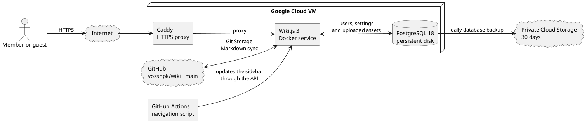

# Using the Wiki

This guide explains how to find pages and contribute to the Voss HPK wiki.

## Find your way around

- Open a group in the sidebar to see the pages it contains.
- Use search when you are looking for a word, place or document.
- Use the locale selector at the top to switch between Nynorsk and English.
- Use **Browse** if you prefer to navigate through the folder tree.

## Pages and folders

A page is a standalone document with its own address.
A landing page gives an overview of the pages in a folder.
Sidebar groups collect links but do not change where pages live in the folder structure.
Pages are written in Markdown, which supports headings, lists, links, images and tables.

## Edit and contribute

Choose **Edit** on a page to change its content if your group has write access.
Use headings and short paragraphs, and link to sources where useful.
Save the page when you are finished, then review it in the normal page view.
Page history shows previous versions and can be used to compare or restore content if you have access.
Use **Create New Page** to create a page where you have write access.
Contributors can create and edit pages, but cannot move or delete pages.
Ask an editor to move or delete a page when needed.
Keep the Nynorsk and English content in step when a page exists in both languages.

## Groups and access

Groups control what you can read and change.
You may belong to more than one group, and page rules can affect access on particular pages.

| Group | Access |
| --- | --- |
| Guests | Can read pages only. |
| Contributors | Can read, create and edit pages; assign tags; view page history; view, upload and manage assets; read and write their own comments; and submit feedback, but cannot review submissions, move or delete pages, manage navigation, use CSS or JavaScript, or manage other people's comments. |
| Editors | Can read, create, edit, review, move and delete pages, assign tags, use CSS and JavaScript, view page history, manage navigation, assets and comments, and submit feedback. |
| Administrators | Manage Wiki.js settings, users, groups and operations. |
| GitHub actions navigation automation | Technical group for the automation that updates the sidebar. |

Contributors can manage uploaded assets even though they cannot move pages.
JavaScript access should be limited to editors with a specific need for it.

## Advanced: how the wiki is set up

The page content is stored as Markdown files in the `vosshpk/wiki` GitHub repository.
Wiki.js synchronizes pages with GitHub through Git Storage.
GitHub Actions runs the navigation script when Markdown files change, keeping the sidebar aligned with the folders and pages.
Wiki.js and PostgreSQL run as Docker services on a Google Cloud VM.
Caddy receives HTTPS traffic and forwards it to Wiki.js.
PostgreSQL stores users, settings and uploaded assets on a separate persistent disk.
A daily database backup is stored in private Cloud Storage and kept for 30 days.
The active installation runs Wiki.js 3, which is still in beta.

::block-plantuml

::

## More help

- [Wiki.js: Markdown](https://docs.js.wiki/guide/markdown)
- [Wiki.js: navigation](https://docs.js.wiki/guide/navigation)
- [Wiki.js: permissions and groups](https://docs.js.wiki/admin/permissions)
- [Wiki.js: moving and deleting pages](https://docs.js.wiki/guide/pages)
