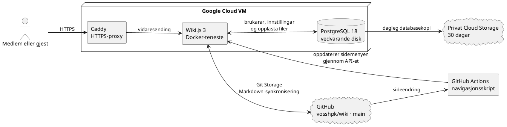

# Infrastruktur

Denne sida forklarer kvar wikien er lagra og kva dei tekniske tenestene gjer.
Ho er meint for teknisk interesserte og dei som driftar wikien.

## Korleis innhaldet blir oppdatert

Sideteksten ligg som Markdown-filer i [GitHub-repositoriet vosshpk/wiki](https://github.com/vosshpk/wiki).
GitHub er ei teneste for å lagre filer, følgje endringar og samarbeide om prosjekt.
Markdown er eit enkelt tekstformat for overskrifter, lister, lenkjer og tabellar.
Wiki.js brukar Git Storage til å synkronisere sidene mellom wikien og hovudgreina main i GitHub.
Synkroniseringa går etter ein fast plan, som for tida er kvart femte minutt.
GitHub Actions køyrer navigasjonsskriptet når sider blir endra, og skriptet ventar på at sidene er synkroniserte før det oppdaterer sidemenyen.
Skriptet legg nye toppmapper som ikkje er førte opp i ei fast navigasjonsgruppe, under **Ugruppert**.
Viss ei slik mappe manglar ei eiga landingsside, blir sidene viste som direkte lenkjer med mappestigen i lenkjeteksten.
Sidene blir verande på den opphavlege stigen; **Ugruppert** er ei gruppe i sidemenyen, ikkje ei fysisk mappe.

## Kva tenestene gjer

| Namn | Forklaring |
| --- | --- |
| Wiki.js | Programvara som viser wikien og lèt medlemer lese og redigere sider. |
| Git | Teknologi som held oversikt over endringar i filer og gjer det mogleg å hente fram tidlegare versjonar. |
| GitHub | Lagrar sidefilene i repositoriet vosshpk/wiki og viser endringshistorikken. |
| Git Storage | Funksjonen i Wiki.js som synkroniserer sideinnhaldet med GitHub. |
| GitHub Actions | Automatisering som køyrer navigasjonsskriptet etter endringar i sidefilene. |
| Markdown | Tekstformatet som sidene er skrivne i. |
| Docker | Køyrer Wiki.js og databasen som isolerte tenester på den virtuelle maskina. |
| Google Cloud VM | Ei virtuell maskin i Google Cloud som køyrer wikien. |
| Caddy | Tek imot HTTPS-trafikk og sender han vidare til Wiki.js. |
| PostgreSQL | Databasen som lagrar brukarar, innstillingar og opplasta filer på ein eigen vedvarande disk. |
| Cloud Storage | Privat lagringsteneste der daglege databasekopiar blir lagra i 30 dagar. |

Wiki.js og PostgreSQL køyrer som Docker-tenester på ei virtuell maskin i Google Cloud.
Caddy tek imot trygg HTTPS-trafikk frå nettlesaren og sender førespurnadene vidare til Wiki.js.
Sideteksten ligg i GitHub, medan brukarar, innstillingar og opplasta filer blir lagra i databasen.
GitHub Actions oppdaterer navigasjonen gjennom Wiki.js API-et etter at Git Storage har henta innhaldet.
Ein dagleg databasekopi blir lagra i eit privat Cloud Storage-område og sletta etter 30 dagar.
Den aktive installasjonen brukar Wiki.js 3, som framleis er betaversjon.

## Gruppene for navigasjonsautomatisering

Gruppa GitHub actions navigation automation blir brukt av API-nøkkelen som oppdaterer sidemenyen.
Ho er ei teknisk gruppe for automatisering og ikkje ei gruppe for vanlege wiki-brukarar.

## Detaljerte grupperettar

Contributors kan bruke taggar, sjå sidehistorikk, laste opp og handtere filer, skrive eigne kommentarar og sende inn tilbakemelding.
Dei kan ikkje godkjenne bidrag, flytte eller slette sider, styre navigasjonen, bruke CSS eller JavaScript eller handtere kommentarane til andre.
Editors kan lese, opprette, redigere, vurdere, flytte og slette sider, bruke taggar, sjå sidehistorikk, styre navigasjonen, handtere filer og kommentarar, bruke CSS og JavaScript og sende inn tilbakemelding.
Administrators forvaltar Wiki.js-innstillingar, brukarar, grupper og drift.

## Arkitektur

::block-plantuml

::
