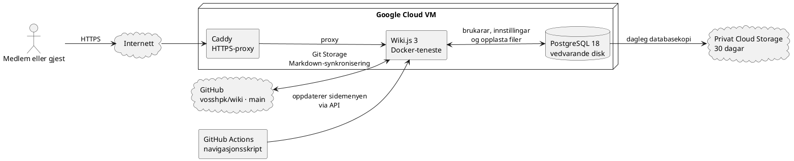

# Slik brukar du wikien

Denne rettleiinga viser korleis du finn sider og bidreg til innhaldet i Voss HPK-wikien.

## Finn fram

- Opna ei gruppe i sidemenyen for å sjå sidene ho inneheld.
- Bruk søkjefeltet når du leitar etter eit ord, ein stad eller eit dokument.
- Bruk språkveljaren øvst for å byte mellom nynorsk og engelsk.
- Bruk **Bla gjennom** dersom du heller vil navigere etter mappestrukturen.

## Sider og mapper

Ei side er eit sjølvstendig dokument med eiga adresse.
Ei landingsside gir oversikt over sidene i ei mappe.
Gruppene i sidemenyen samlar lenkjer, men endrar ikkje kvar sidene ligg i mappestrukturen.
Sidene er skrivne i Markdown, som gjer det mogleg å bruke overskrifter, lister, lenkjer, bilete og tabellar.

## Rediger og bidra

Vel **Edit** på ei side for å endre innhaldet dersom gruppa di har skrivetilgang.
Bruk overskrifter og korte avsnitt, og lenk til kjelder når det er nyttig.
Lagre sida når du er ferdig, og sjå gjennom resultatet på vanleg sidevising.
Sidehistorikken viser tidlegare versjonar og kan brukast til å samanlikne eller gjenopprette innhald dersom du har tilgang.
Bruk **Create New Page** for å opprette ei side der du har skrivetilgang.
Bidragsytarar kan opprette og redigere sider, men kan ikkje flytte eller slette sider.
Ta kontakt med ein redaktør dersom ei side må flyttast eller slettast.
Hald nynorsk og engelsk innhald oppdatert når ei side finst på begge språka.

## Grupper og tilgang

Gruppene styrer kva du kan lese og endre.
Du kan vere medlem av fleire grupper, og sidereglar kan påverke tilgangen på bestemte sider.

| Gruppe | Tilgang |
| --- | --- |
| Guests | Kan berre lese sider. |
| Contributors | Kan lese, opprette og redigere sider; tilordne taggar; sjå sidehistorikk; sjå, laste opp og handtere filer; lese og skrive eigne kommentarar; og sende inn tilbakemelding, men kan ikkje godkjenne bidrag, flytte eller slette sider, administrere navigasjonen, bruke CSS eller JavaScript eller handtere andre sine kommentarar. |
| Editors | Kan lese, opprette, redigere, vurdere, flytte og slette sider, tilordne taggar, bruke CSS og JavaScript, sjå sidehistorikk, administrere navigasjon, filer og kommentarar, og sende inn tilbakemelding. |
| Administrators | Forvaltar Wiki.js-innstillingar, brukarar, grupper og drift. |
| GitHub actions navigation automation | Teknisk gruppe for automasjonen som oppdaterer sidemenyen. |

Bidragsytarar kan handtere opplasta filer sjølv om dei ikkje kan flytte sider.
Tilgangen til JavaScript bør avgrensast til redaktørar som har særleg behov for det.

## Avansert: slik er wikien sett opp

Innhaldssidene ligg som Markdown-filer i GitHub-repositoriet `vosshpk/wiki`.
Wiki.js synkroniserer sidene med GitHub gjennom Git Storage.
GitHub Actions køyrer navigasjonsskriptet når Markdown-filer blir endra, slik at sidemenyen følgjer mappene og sidene.
Wiki.js og PostgreSQL køyrer som Docker-tenester på ein Google Cloud VM.
Caddy tek imot HTTPS-trafikk og sender han vidare til Wiki.js.
PostgreSQL lagrar mellom anna brukarar, innstillingar og opplasta filer på ein eigen vedvarande disk.
Ei dagleg databasekopi blir lagra i privat Cloud Storage og vert teken vare på i 30 dagar.
Den aktive installasjonen brukar Wiki.js 3, som framleis er i beta.

::block-plantuml

::

## Meir hjelp

- [Wiki.js: Markdown](https://docs.js.wiki/guide/markdown)
- [Wiki.js: navigasjon](https://docs.js.wiki/guide/navigation)
- [Wiki.js: tilgangar og grupper](https://docs.js.wiki/admin/permissions)
- [Wiki.js: flytte og slette sider](https://docs.js.wiki/guide/pages)
